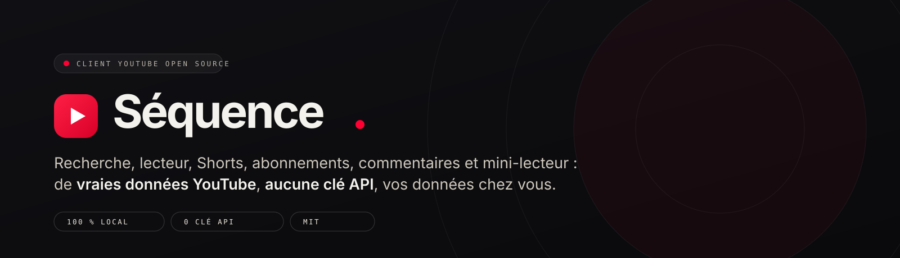
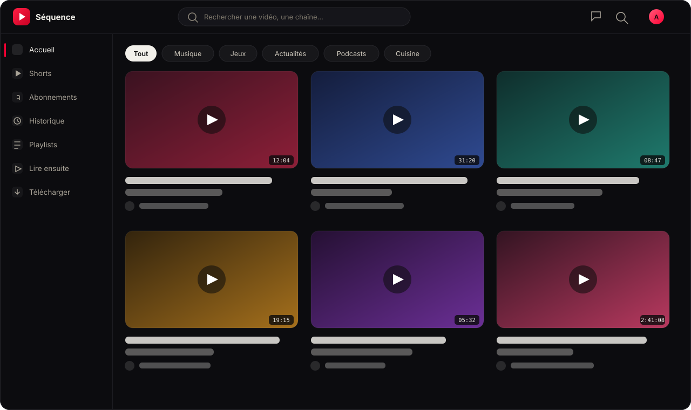
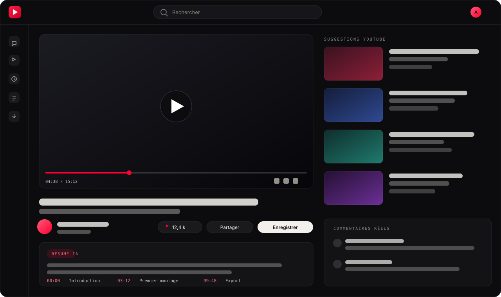
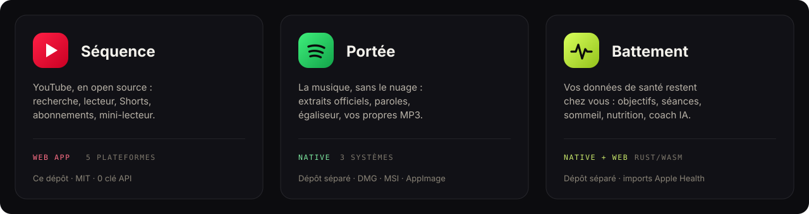
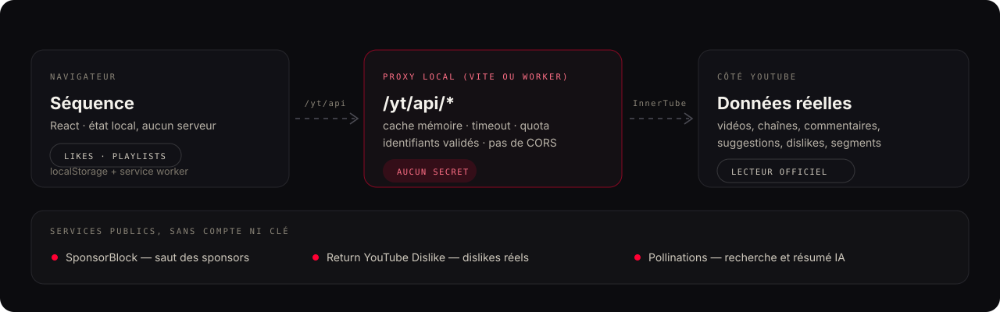

<div align="center">



[](https://github.com/DmzGamingYT/tubecraft/actions/workflows/ci.yml)


**Un client YouTube complet, open source, sans clé API et sans serveur à vous.**
Recherche, lecteur, Shorts, abonnements, commentaires, playlists et mini-lecteur persistant —
avec de **vraies données YouTube** et vos données qui restent dans le navigateur.

[**▶ Ouvrir TubeCraft**](https://site-837caca50a67485a994f4549b9ef7404.freebuff.page) ·
[**⬇ Installer**](#installer) ·
[**🧩 La collection**](#la-collection-craftline) ·
[**📋 Audit & feuille de route**](AUDIT.md)

</div>

> Projet indépendant, **non affilié à YouTube / Google**. InnerTube n'est pas une API publique :
> elle peut changer sans préavis. Voir [AUDIT.md](AUDIT.md) pour les limites et la suite prévue.

---

## Aperçu

<table>
<tr>
<td width="50%">

<p align="center"><em>Accueil — grille progressive, chips de catégories, étagère Shorts, « Reprendre la lecture ».</em></p>
</td>
<td width="50%">

<p align="center"><em>Lecture — lecteur officiel, likes réels, résumé IA à chapitres cliquables, suggestions live.</em></p>
</td>
</tr>
</table>

<p align="center"><sub>Maquettes d’interface reproduisant l’app réelle (thème nuit). L’app en ligne est interactive : <a href="https://site-837caca50a67485a994f4549b9ef7404.freebuff.page">la tester</a>.</sub></p>

---

## Ce qui est inclus

| | Domaine | Détail |
|:--:| --- | --- |
| 🏠 | **Accueil** | grille progressive (24 par 24), chips de catégories, étagère Shorts, « Reprendre la lecture », recommandations **explicables** avec signaux négatifs |
| ▶️ | **Lecture** | lecteur YouTube officiel, **vraies métadonnées** (titre, vues, description, tags, catégorie), likes et **dislikes réels**, **résumé IA + chapitres cliquables**, reprise de lecture, file d'attente de playlist |
| ✨ | **Suggestions** | **suggestions YouTube en direct** pour la vidéo regardée, avec repli sur le catalogue |
| 🔍 | **Recherche** | recherche live, **pagination par continuation**, tri (pertinence / vues), filtres vidéos et durée, assistance IA gratuite |
| 📺 | **Chaînes** | en-tête réel (avatar, bannière, handle, abonnés, description), onglets Vidéos / Shorts, pagination |
| 📱 | **Shorts** | flux vertical plein écran, un seul lecteur actif à la fois, clavier ↑/↓, partage, historique |
| 💬 | **Commentaires** | **vrais commentaires YouTube paginés** + commentaires locaux (réponses, likes, suppression) |
| 🗂️ | **Bibliothèque** | abonnements (nouveautés live), historique groupé par jour, vidéos likées, playlists, « Regarder plus tard », **file « Lire ensuite » universelle** |
| 👤 | **Compte** | Google OAuth (bouton officiel) ou comptes locaux, sélecteur de comptes, **données isolées par profil**, avatar |
| ⚙️ | **Paramètres** | thème, lecture (autoplay, boucle, théâtre, sous-titres, vitesse, volume), IA, SponsorBlock, profils, export/import JSON et effacement sélectif ou total |
| 🧭 | **Confort** | thème sombre/clair, raccourcis `Ctrl/⌘+B` et `/`, lien d'évitement, routes à la demande, responsive, **mode avion** avec cache local |
| ⏭️ | **SponsorBlock** | saut automatique des sponsors, intros, autopromotions et autres segments (désactivable sous chaque vidéo) |

<details>
<summary><strong>File « Lire ensuite »</strong></summary>

Ajoutez n'importe quelle vidéo à une file personnelle depuis sa vignette ou le menu
**Enregistrer** ; la page **Lire ensuite** (`/queue`) permet de réordonner, retirer ou vider la file.
Elle devient automatiquement la suite de lecture du lecteur et du mini-lecteur, sans écraser les
playlists explicites ni « Regarder plus tard ». Chaque profil a sa propre file, persistée
localement.

</details>

<details>
<summary><strong>Recommandations explicables</strong></summary>

Le rayon « Recommandés pour vous » calcule son classement dans le navigateur et affiche la raison
de chaque carte : chaîne abonnée, catégorie déjà regardée, affinité avec une chaîne de l'historique
ou popularité. « Pas intéressé » masque la vidéo, « Moins de cette chaîne » retire toutes ses
suggestions, et les vidéos dislikées sont exclues. Le panneau « Pourquoi ces vidéos ? » détaille les
signaux et permet de tout réactiver.

</details>

<details>
<summary><strong>Notifications live</strong></summary>

La cloche interroge les dernières vidéos des chaînes abonnées via le proxy, par lots de quatre. Le
relevé est mis en cache 10 minutes (et survit au rechargement), le badge ne compte que les nouveautés
non lues, et le catalogue embarqué sert de repli si YouTube est injoignable. Le niveau « Aucune »
d'une chaîne l'exclut du relevé.

</details>

<details>
<summary><strong>Mode avion</strong></summary>

Le service worker met en cache la coquille, les assets, les dernières réponses GET de `/yt/api` et
les vignettes déjà vues. Hors ligne, un bandeau explique ce qui reste disponible : pages et
métadonnées en cache, likes, playlists, historique et file restent modifiables localement ; la
lecture vidéo nécessite une connexion. Le cache se vide depuis **Paramètres → Mode avion**. Aucune
requête d'écriture ni route de débogage n'est mise en cache.

</details>

---

## Installer

**Le plus simple : installer la web app depuis le navigateur.** Une seule app, cinq plateformes,
pas d'installeur à décompresser — le navigateur crée une icône, une fenêtre et un raccourci, puis
TubeCraft se met à jour toute seule.

| Plateforme | Comment |
| --- | --- |
| 🍎 **macOS** | [ouvrir l'app](https://site-837caca50a67485a994f4549b9ef7404.freebuff.page) → Chrome / Edge : icône d'installation dans la barre d'adresse · Safari 17+ : *Fichier → Ajouter au Dock* |
| 🪟 **Windows** | Chrome ou Edge → icône d'installation dans la barre d'adresse |
| 🐧 **Linux** | Chrome, Edge ou Chromium → « Installer TubeCraft » |
| 🤖 **Android** | Chrome → menu ⋮ → « Ajouter à l'écran d'accueil » |
| 🍏 **iPhone / iPad** | Safari → Partager → « Sur l'écran d'accueil » |

La page `#telecharger` de l'app et de la vitrine détaille chaque plateforme et sélectionne
automatiquement l'onglet détecté. Les binaires natifs signés (DMG, MSI, AppImage, APK) seront
annoncés sur GitHub après la première version stable.

<details>
<summary><strong>Application de bureau (Tauri 2)</strong></summary>

Le dépôt contient un shell **Tauri 2** dans `src-tauri/` : une vraie fenêtre native (1440 × 900,
redimensionnable) qui garde les données locales de l'app et envoie les liens externes vers le
navigateur par défaut. Le build de production charge l'application hébergée sur Freebuff Sites, donc
le desktop profite des mises à jour du site et du proxy InnerTube sans rebuild ; en développement, il
charge le serveur Vite local.

Prérequis : Rust 1.90+, Node 20+, Xcode Command Line Tools sur macOS, WebView2 sur Windows et
WebKitGTK sur Linux.

| Commande | Rôle |
| --- | --- |
| `npm run dev:desktop` | lance Vite puis la fenêtre Tauri avec HMR |
| `npm run build:desktop` | compile le binaire et les paquets natifs |
| `npm run icon` | régénère toutes les icônes depuis `src-tauri/app-icon.svg` |

Sur un Mac Apple Silicon, le build produit
`src-tauri/target/release/bundle/macos/TubeCraft.app` et
`.../dmg/TubeCraft_0.1.0_aarch64.dmg`. Les paquets Windows (MSI/NSIS) et Linux (AppImage/DEB) se
compilent sur leur système respectif.

L'icône est dessinée en SVG dans [`src-tauri/app-icon.svg`](src-tauri/app-icon.svg) : verre rubis
translucide, biseau clair, réfractions et triangle de lecture en verre. `npm run icon` la décline en
ICNS, ICO et PNG pour toutes les tailles.

> Les paquets produits localement sont **ad-hoc / non notariés** : Gatekeeper peut demander un clic
> droit → « Ouvrir ». Une distribution publique demande un certificat Developer ID, une notarisation
> Apple et des builds signés par plateforme. `TUBECRAFT_START_URL` permet d'ouvrir directement une
> page pour les tests.

</details>

---

## La collection Craftline



TubeCraft est la première app de **Craftline**, une collection d'outils open source qui refusent
l'abonnement et la télémétrie. La vitrine de la collection est incluse dans ce dépôt, à la route
[`/apps`](https://site-837caca50a67485a994f4549b9ef7404.freebuff.page/apps).

| App | Statut | Dépôt |
| --- | --- | --- |
| **TubeCraft** — YouTube | disponible (web + desktop) | ce dépôt |
| **SpotifyCraft** — musique | disponible (web + natif) | [DmzGamingYT/spotifycraft](https://github.com/DmzGamingYT/spotifycraft) |
| **PulseCraft** — santé | disponible (natif + web) | [DmzGamingYT/pulsecraft](https://github.com/DmzGamingYT/pulsecraft) |

La vitrine présente chaque app avec une **démo d'interface animée**, une **visite guidée** pas à pas,
une galerie plein écran, un thème papier / nuit et une section « À l'étude » qui liste les
propositions sans jamais les présenter comme terminées.

---

## Sous le capot



TubeCraft ne demande **aucune clé API Google** : elle parle à **InnerTube** (le canal que
youtube.com utilise lui-même) via un proxy local, et lit les vidéos avec le **lecteur officiel**
YouTube (iframe). Les métadonnées, résultats de recherche, suggestions et commentaires affichés sont
donc de vraies données YouTube.

<details>
<summary><strong>Pourquoi un proxy ?</strong></summary>

InnerTube n'autorise pas les requêtes cross-origin depuis un navigateur. Le plugin Vite expose donc
des routes locales `/yt/api/*` qui interrogent YouTube côté serveur — aucune clé, aucun secret
stocké. Pour un déploiement statique, ces routes doivent être hébergées séparément (voir
[Déploiement](#déploiement)).

</details>

<details>
<summary><strong>Routes du proxy</strong></summary>

| Route | Réponse |
| --- | --- |
| `GET /yt/api/search?q=&continuation=&sort=&type=` | résultats normalisés + jeton de continuation |
| `GET /yt/api/video?v=` | métadonnées, chaîne, likes/dislikes, suggestions |
| `GET /yt/api/channel?id=&tab=&continuation=` | en-tête de chaîne + vidéos + continuation |
| `GET /yt/api/player?v=` | réponse `player` InnerTube brute (utilisée par `npm run catalog`) |
| `GET /yt/api/comments?v=&continuation=` | commentaires + continuation |
| `GET /yt/api/suggest?q=` | autocomplétion |
| `GET /yt/api/sponsorblock?v=` | segments SponsorBlock |
| `GET /yt/api/ai?q=` | plan de recherche IA |
| `POST /yt/api/summary` | résumé + chapitres d'une vidéo (métadonnées validées, cache 6 h) |
| `GET /yt/api/raw?q=` | JSON InnerTube brut, **développement uniquement** |

Le proxy applique un **timeout**, un **cache mémoire**, une **limite de requêtes** par IP, valide les
identifiants et ne renvoie pas d'en-tête CORS permissif. Les réponses ne sont jamais mises en cache
par le navigateur (`Cache-Control: no-store`).

</details>

<details>
<summary><strong>Recherche assistée par IA (gratuite, sans clé)</strong></summary>

La page de résultats utilise une **IA gratuite et sans clé** ([Pollinations](https://pollinations.ai))
pour reformuler la requête, proposer des **recherches associées** et afficher l'**intention**
détectée. Aucune inscription n'est nécessaire.

Le palier gratuit limite à environ **1 requête / 30 s par IP** : les plans sont mis en cache dans la
session et, si l'IA est indisponible, la recherche YouTube classique prend le relais sans erreur
visible. Le bouton **« IA activée / désactivée »** coupe la fonctionnalité.

</details>

<details>
<summary><strong>Résumé IA et chapitres de la vidéo</strong></summary>

Sous chaque vidéo, une carte **Résumé IA** condense la description et les métadonnées (titre,
chaîne, durée, date, catégorie, tags) en quelques phrases, puis propose des **chapitres
cliquables** : un clic déplace le lecteur YouTube au bon timestamp, sans recharger la page.

- génération automatique à l'ouverture, mise en cache pour la session (pas d'appel répété) ;
- bouton **Régénérer** pour relancer à la demande ;
- chapitres validés (strictement croissants, bornés à la durée, 10 maximum) ;
- si l'IA est indisponible, un **résumé extractif** de la description et les chapitres déjà
  horodatés par la chaîne sont affichés, avec un badge « Automatique » — aucun chapitre inventé ;
- désactivable dans **Paramètres → IA et confort de visionnage**.

</details>

<details>
<summary><strong>SponsorBlock et dislikes réels</strong></summary>

- [SponsorBlock](https://sponsor.ajay.app) (API publique, sans clé) fournit des segments
  communautaires. Le lecteur les saute pendant la lecture et affiche un badge temporaire. Le réglage
  est persisté et se coupe sous chaque vidéo.
- [Return YouTube Dislike](https://returnyoutubedislike.com) (API publique, sans clé) rétablit le
  nombre de dislikes, que YouTube n'expose plus. Si l'API ne répond pas, seul le nombre de likes est
  affiché.

Ces deux services sont **optionnels** : une panne est silencieuse et ne bloque jamais la lecture.

</details>

---

## Vie privée et compte

Aucun compte factice n'est pré-rempli :

- **Google** — vraie connexion OAuth via Google Identity Services dès que `VITE_GOOGLE_CLIENT_ID`
  est renseigné.
- **Microsoft / Apple / GitHub / adresse e-mail** — création d'un **compte local** avec vos propres
  nom et adresse. Rien n'est envoyé à un serveur : tout reste dans le `localStorage`.
- **Choisir un compte** — les comptes utilisés sont mémorisés pour se reconnecter en un clic.
- **Données par profil** — likes, dislikes, abonnements, historique, playlists, « Regarder plus
  tard », progression, commentaires et préférences de notifications sont propres à chaque profil. Le
  thème et les réglages de lecture restent communs au navigateur. Les données existantes sont
  rattachées automatiquement au profil actif (ou au profil invité) au premier lancement de cette
  version : rien n'est supprimé.
- **Export / import / effacement** — depuis **Paramètres**, export JSON complet, import, effacement
  sélectif ou total, et vidage du cache du mode avion.

<details>
<summary><strong>Activer une vraie connexion Google</strong></summary>

1. Créez un **ID client OAuth** de type *Application Web* sur
   [console.cloud.google.com](https://console.cloud.google.com) (API et services → Identifiants).
2. Ajoutez vos origines autorisées : `http://127.0.0.1:5183`, `http://localhost:5183` et, si
   besoin, l'URL de votre déploiement.
3. Copiez `.env.example` en `.env` et renseignez
   `VITE_GOOGLE_CLIENT_ID=...apps.googleusercontent.com`.
4. Relancez `npm run dev`.

> ⚠️ La connexion Google ne sert qu'à récupérer nom, e-mail et photo. TubeCraft ne demande
> **aucun scope YouTube** et ne peut pas agir sur votre compte Google. Les « comptes locaux » ne sont
> pas une authentification : ne les considérez pas comme une protection.

</details>

---

## Développer

```bash
git clone https://github.com/DmzGamingYT/tubecraft.git
cd tubecraft
npm install
npm run dev        # http://127.0.0.1:5183
```

Sur macOS, vous pouvez aussi **double-cliquer sur `Démarrer TubeCraft.command`** : le script installe
les dépendances si besoin, lance le serveur et ouvre le navigateur.

| Commande | Rôle |
| --- | --- |
| `npm run dev` | serveur de développement + proxy InnerTube |
| `npm run build` | vérification TypeScript puis build de production dans `dist/` |
| `npm run preview` | sert `dist/` (le proxy InnerTube reste actif) |
| `npm run typecheck` | vérification TypeScript seule (app + vitrine) |
| `npm test` | tests unitaires Vitest |
| `npm run catalog` | régénère le catalogue embarqué depuis YouTube (serveur dev requis) |
| `npm run dev:showcase` | vitrine seule sur `http://127.0.0.1:5185` |
| `npm run build:showcase` | build de la vitrine dans `dist-showcase/` |
| `npm run build:site` | build du front + bundle du Worker dans `dist-worker/` |

<details>
<summary><strong>Structure du dépôt</strong></summary>

```
vite.config.ts             config Vite + plugin proxy
server/ytProxy.ts          proxy InnerTube + parsing (search, video, channel, comments, SponsorBlock)
server/ytProxy.test.ts     tests des parseurs
worker/index.ts            Worker Cloudflare (assets + /yt/api) pour le déploiement
src/api/youtube.ts         couche cliente typée (cache mémoire, repli catalogue)
src/lib/ai.ts              recherche assistée par IA
src/lib/chapters.ts        détection des chapitres et des horodatages
src/lib/userData.ts        export/import/effacement des données locales (liste blanche de clés)
src/lib/url.ts             URLs absolues compatibles base Vite (GitHub Pages)
src/data/                  catalogue généré, index, registre des vidéos/chaînes découvertes
src/store.ts               état persistant (thème, likes, abonnements, historique, commentaires)
src/components/            barre haute, barre latérale, cartes, commentaires, lecteur…
src/components/showcase/   vitrine (démos animées, visite guidée, galerie, « Sous le capot »)
src/pages/                 routes chargées à la demande
showcase/                  entrée du site vitrine autonome
src-tauri/                 shell desktop Tauri 2
```

</details>

<details>
<summary><strong>Vitrine autonome (<code>/apps</code>)</strong></summary>

La collection s'appelle **Craftline** : un C ouvert et un triangle de lecture sur une tuile rouge,
dessinés dans `CraftlineMark.tsx` et repris par le favicon. La présentation des apps existe à deux
endroits, à partir du **même composant** (`src/components/ShowcaseSite.tsx`) :

- `/apps` dans l'application (route React, hors du chrome YouTube) ;
- un **site statique séparé**, compilé dans `dist-showcase/`.

`dist-showcase/` est **portable** : les chemins d'assets sont relatifs (`base: './'`), donc le
dossier peut être déposé à la racine d'un domaine ou dans un sous-dossier (GitHub Pages de projet,
Netlify Drop, Cloudflare Pages…) sans rebuild.

```bash
npm run build:showcase
python3 -m http.server 8080 --directory dist-showcase
```

Pour que les boutons « Ouvrir TubeCraft » pointent vers l'application déployée, renseignez
`VITE_APP_URL` **au moment du build** :

```bash
VITE_APP_URL=https://mon-tubecraft.example npm run build:showcase
```

Sans cette variable, la vitrine renvoie vers le profil GitHub au lieu d'afficher un lien mort. Les
apps et leurs liens vivent dans `src/data/apps.ts` ; la section **« À l'étude »** est alimentée par
`src/data/proposals.ts` (statuts `exploring` / `proposed` uniquement).

</details>

---

## Déploiement

**TubeCraft est en ligne gratuitement sur Freebuff Sites :**

- application : <https://site-837caca50a67485a994f4549b9ef7404.freebuff.page>
- aperçu de préproduction : <https://site-ec05ebb2a2f4432ab76b5023e70af9b2.freebuff.page>

Un seul Worker Cloudflare sert à la fois les assets du build Vite et le proxy `/yt/api/*`. Il n'y a
**ni clé API ni secret** : InnerTube, SponsorBlock, Return YouTube Dislike et Pollinations sont
publics. Le code du Worker vit dans `worker/index.ts` ; il réutilise les parseurs et les appels de
`server/ytProxy.ts`, avec un cache mémoire par isolate et une limite de 240 requêtes par minute et
par IP.

```bash
npm run build:site          # build Vite + bundle du Worker dans dist-worker/
npx wrangler dev            # test local sur http://127.0.0.1:8787 (workerd)
```

Le manifeste [`sites.manifest.json`](sites.manifest.json) décrit le Worker (`dist-worker/index.js`)
et les assets (`dist/`) ; c'est lui qui est envoyé à Freebuff Sites. Le projet est aussi décrit dans
`wrangler.toml` pour les tests locaux.

<details>
<summary><strong>Autres hébergeurs</strong></summary>

`npm run build` génère un site statique dans `dist/`. Le front seul suffit pour le catalogue
embarqué, mais **la recherche live, les pages chaîne/vidéo et les commentaires nécessitent le
proxy**. Deux options :

1. **Hébergement avec fonctions serveur** (Cloudflare Workers, Vercel, Netlify…) : portez les
   handlers de `server/ytProxy.ts` sur la plateforme et exposez les mêmes chemins `/yt/api/*`. Le
   front n'a pas à changer.
2. **Site purement statique** : l'application reste utilisable avec le catalogue local, mais affiche
   « hors ligne — catalogue local » pour la recherche.

> Sur Freebuff Sites, le relais IA côté Worker peut être refusé par Pollinations (l'API gratuite
> bloque certaines IP de datacenter). Le navigateur interroge d'abord Pollinations en direct et
> retombe sur la recherche classique si l'IA est indisponible : la recherche reste fonctionnelle.

Pour GitHub Pages sur `https://<pseudo>.github.io/<repo>/` :

```bash
npm run build -- --base=/<repo>/
```

L'application lit `import.meta.env.BASE_URL` pour le routeur, les partages et les liens absolus.
Ajoutez aussi un `404.html` identique à `index.html` (ou une redirection) pour que les routes
profondes (`/watch`, `/channel`, `/search`) fonctionnent au rechargement.

</details>

---

## Tests et CI

```bash
npm test
```

Les tests couvrent les parseurs InnerTube (vidéo, lockup, chaîne, commentaires, pagination), le
formatage français, les chapitres/horodatages, l'export/import des données, les sélecteurs du
catalogue, la file « Lire ensuite », les recommandations (explications et signaux négatifs), la
fusion des notifications et la mémoire de la visite guidée. Le workflow
[.github/workflows/ci.yml](.github/workflows/ci.yml) exécute `typecheck`, `test`, `build` et
`build:showcase` sur chaque push et pull request.

## Limites connues

- Les vidéos dont la chaîne a **désactivé l'intégration** ne peuvent pas être lues dans un iframe.
  TubeCraft utilise uniquement le lecteur officiel, jamais d'URL de flux extraite.
- La lecture automatique peut être bloquée par le navigateur : cliquez sur ▶ dans le lecteur.
- InnerTube est une API non contractuelle : si YouTube change de format, `npm run catalog`, la
  recherche et le parsing peuvent nécessiter une mise à jour.
- Le tri « plus récentes » n'est pas exposé : InnerTube l'accepte mais l'ordre renvoyé reste mixte.
  Seuls « pertinence » et « plus vues » sont proposés.
- Les réponses aux commentaires sont comptées mais pas encore chargées.
- InnerTube et les services communautaires peuvent être bloqués selon votre réseau ou votre pays.
- Projet indépendant, non affilié à YouTube / Google. Le nom, les contenus et les marques YouTube
  appartiennent à leurs propriétaires.

## Licence

TubeCraft est publié sous licence [MIT](LICENSE) — libre à chacun d'utiliser, modifier et
redistribuer.
